# durable-powerbi-refresh

[](https://github.com/MateoCuenca09/durable-powerbi-refresh/actions/workflows/ci.yml)


Orchestrates **Power BI dataset refreshes** with **Azure Durable Functions** (Python): it
triggers the refreshes, follows each one until it really finishes, refreshes dependent
models in stages, and posts a summary to Teams, Slack or any webhook.

## Why not just call the API from Data Factory?

The common pattern is a Data Factory pipeline with a Web activity that calls
`POST /refreshes`, followed by an `Until` loop of `Wait` + `Web` activities that polls the status. It works, but:

| Problem | Data Factory polling loop | This project |
|---|---|---|
| **Cost** | Every loop iteration is billed as several activity runs, for as long as the refresh takes | Durable **timers cost nothing while sleeping**; you only pay for a few short activity runs |
| **False successes** | The `POST` returns `202 Accepted`, and pipelines often treat that as success. Polling "the latest refresh" can read an older run | Tracks **the exact refresh id** returned in `Location` until it reaches `Completed`, `Failed`, `Cancelled` or a timeout |
| **Dependencies** | Hand-built chains of activities | Declarative `stages`: parallel inside a stage, sequential across stages; a failure stops downstream models |
| **Testing** | Hard to test outside the portal | Orchestrators are plain Python generators, unit-tested with a fake runtime |

In production, this pattern cut refresh orchestration cost by **about 90%** compared with ADF polling.

## Architecture

```mermaid
flowchart TB
    H[HTTP POST /api/refresh] --> A
    T[Timer trigger<br/>REFRESH_SCHEDULE + REFRESH_PLAN] --> A
    subgraph Durable Functions
      A[refresh_all<br/>orchestrator] -->|stage 1: fan-out| D1[refresh_dataset<br/>sub-orchestrator]
      A -->|stage 1: fan-out| D2[refresh_dataset]
      A -->|stage 2, if stage 1 ok| D3[refresh_dataset]
      D1 --> TR[trigger_refresh<br/>activity]
      TR --> W{{durable timer<br/>30s → 60s → 120s … 5 min}}
      W --> GS[get_refresh_status<br/>activity]
      GS -->|still running| W
      A --> N[send_summary<br/>activity]
    end
    TR -->|POST enhanced refresh| PBI[(Power BI REST API)]
    GS -->|GET /refreshes/&#123;id&#125;| PBI
    N --> WH[Teams / Slack webhook]
```



- **Auth**: `DefaultAzureCredential`, so Managed Identity in Azure and `az login` locally.
  The identity needs access to the workspaces, and a tenant admin must allow service
  principals to use Power BI APIs.
- **Throttling**: `429` responses are retried and honor `Retry-After`.
- **Backoff**: polls at 30s, 60s, 120s, 240s, then every 5 minutes, up to `timeout_minutes`
  per dataset (default 120).

## Request format

```jsonc
POST /api/refresh?code=<function-key>
{
  "stages": [
    [   // stage 1: refreshed in parallel
      { "workspace_id": "<guid>", "dataset_id": "<guid>", "name": "Sales" },
      { "workspace_id": "<guid>", "dataset_id": "<guid>", "name": "Finance" }
    ],
    [   // stage 2: only if all of stage 1 succeeded
      { "workspace_id": "<guid>", "dataset_id": "<guid>", "name": "Executive", "timeout_minutes": 60 }
    ]
  ]
}
```

`{"datasets": [...]}` is shorthand for a single stage. The response is the standard Durable
status payload: poll `statusQueryGetUri` to get the final summary:

```json
{
  "ok": false, "succeeded": 1, "failed": 1, "skipped": ["Executive"],
  "results": [
    { "name": "Sales",   "status": "Succeeded", "polls": 3, "duration_seconds": 210, "refresh_id": "…", "error": null },
    { "name": "Finance", "status": "Failed",    "polls": 2, "duration_seconds": 90,  "refresh_id": "…", "error": "Credentials expired" }
  ]
}
```

## Run locally

Requirements: Python 3.11+, [Azure Functions Core Tools v4](https://learn.microsoft.com/azure/azure-functions/functions-run-local)
and [Azurite](https://learn.microsoft.com/azure/storage/common/storage-use-azurite) (Durable Functions needs storage).

```bash
git clone https://github.com/MateoCuenca09/durable-powerbi-refresh.git
cd durable-powerbi-refresh
python -m venv .venv && source .venv/bin/activate   # Windows: .venv\Scripts\activate
pip install -r requirements-dev.txt
cp local.settings.example.json local.settings.json  # POWERBI_FAKE=1: no tenant needed
azurite --silent &                                    # or the VS Code Azurite extension
func start
```

```bash
curl -X POST http://localhost:7071/api/refresh -H "Content-Type: application/json" \
  -d '{"stages": [[{"workspace_id":"ws","dataset_id":"sales"},{"workspace_id":"ws","dataset_id":"will-fail"}],[{"workspace_id":"ws","dataset_id":"exec"}]]}'
```

With `POWERBI_FAKE=1` a refresh "completes" after 20 seconds, and any dataset id containing
`fail` fails, so you can watch both paths and the skipped stage. Set `POWERBI_FAKE=0` and
run `az login` to hit the real API.

## Tests

```bash
pytest -v
```

`tests/fake_durable.py` is a small in-process runtime: it drives the orchestrator generators,
runs activities synchronously and advances a fake clock on each durable timer. The tests check
backoff timing, success, failure, trigger errors, timeouts, stage ordering, downstream skipping,
throttling, refresh-id parsing and payload validation. A smoke test confirms that the Functions app
registers all seven functions. CI runs ruff and pytest on every push.

## Deploy

```bash
az functionapp create --name <app> --resource-group <rg> --storage-account <sa> \
  --flexconsumption-location <region> --runtime python --runtime-version 3.11 \
  --assign-identity
func azure functionapp publish <app>
```

Then add the app's managed identity to each Power BI workspace (Member or Contributor) and set
`REFRESH_SCHEDULE`, `REFRESH_PLAN` and `NOTIFY_WEBHOOK_URL` in the app settings.
Keep the webhook URL in Key Vault.

## Configuration

| Setting | Purpose |
|---|---|
| `POWERBI_FAKE` | `1` = simulated API (local demo), `0` = real Power BI |
| `POWERBI_FAKE_DURATION` | Seconds a fake refresh takes (default 20) |
| `REFRESH_SCHEDULE` | NCRONTAB for the timer trigger, e.g. `0 0 6 * * *` |
| `REFRESH_PLAN` | JSON payload (same format as the HTTP body) for scheduled runs |
| `NOTIFY_WEBHOOK_URL` | Optional webhook for the run summary |

## License

MIT
